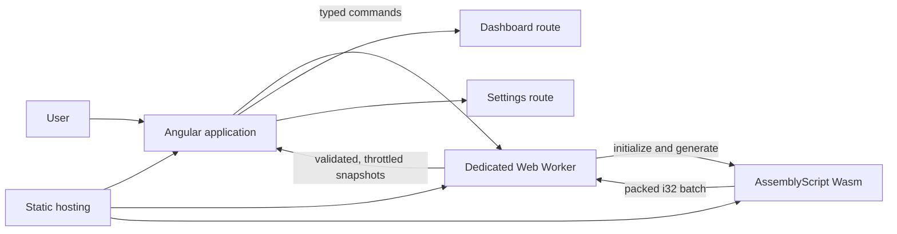
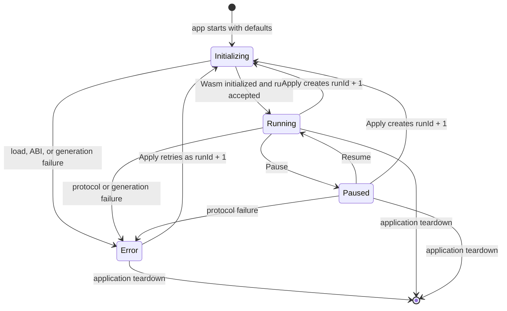

# Architecture

| Field                | Value                                                                                                              |
| -------------------- | ------------------------------------------------------------------------------------------------------------------ |
| Status               | Runtime implemented locally; verification and deployment pending                                                   |
| Owner                | Repository maintainer                                                                                              |
| Version              | 1.0                                                                                                                |
| Last reviewed        | 2026-10-21                                                                                                         |
| Upstream requirement | [TASK.md](../TASK.md)                                                                                              |
| Related decision     | [ADR-0001: Use AssemblyScript for the market generator](decisions/0001-use-assemblyscript-for-market-generator.md) |
| Downstream plan      | [IMPLEMENTATION_PLAN.md](IMPLEMENTATION_PLAN.md)                                                                   |
| Failure policy       | [ERROR_HANDLING.md](ERROR_HANDLING.md)                                                                             |

Review this document when the assignment changes, the Wasm ABI changes, a second producer is added,
the supported browser baseline changes, or measured performance invalidates the current budgets.

## 1. Purpose and quality attributes

The application must produce stateful simulated market updates in WebAssembly, process every update
without blocking Angular, and keep one active run across route changes. The architecture prioritizes:

1. **Correct cumulative metrics.** Every trade in the active run contributes exactly once.
2. **Lifecycle correctness.** Pause, resume, Apply, route navigation, and teardown have explicit
   semantics.
3. **Stale-result safety.** An older asynchronous run cannot overwrite a newer run.
4. **Responsiveness.** The maximum configured nominal rate is 20,000 updates per second.
5. **Explainability.** The implementation must remain small enough to discuss and modify during an
   interview.
6. **Feature ownership.** Code is grouped by product capability, with no generic `core`, `models`,
   `services`, or `utils` buckets.

Evidence labels used below:

- **Required:** stated by `TASK.md`.
- **Observed:** verified in the current repository or installed toolchain.
- **Decided:** an implementation choice made here.
- **Assumed:** must be validated during implementation.

## 2. System context

The browser is the only runtime. Angular renders the two routes and owns user commands. One dedicated
Web Worker owns scheduling, the AssemblyScript Wasm instance, and cumulative metric state. The Wasm
module owns randomness and per-instrument market-generation state. Deployment serves static Angular,
worker, and `.wasm` artifacts from the same versioned build.



Angular never calls the generator directly. The worker never owns presentation state. Wasm never
knows about symbols, routes, timers, formatting, or Angular.

## 3. Feature-oriented source boundaries

The repository keeps the existing top-level feature slices and replaces scaffold-only files with
real behavior:

```text
src/app/
  app.ts                       application composition and eager producer startup
  app.routes.ts                route composition
  features/
    market-producer/           live-market production capability
      market-producer.facade.ts public Angular facade; the feature's public entry point
      market-producer.types.ts active settings, status, snapshots, commands
      producer-settings.ts     defaults, limits, and validation rules
      producer.worker.ts
      producer-controller.ts
      worker.protocol.ts
      wasm-generator.ts
      metric-accumulator.ts
    dashboard/                 observe and control the active run
      dashboard.ts
      market-metric-formatters.ts
    settings/                  edit and apply a new producer run
      settings.ts
assembly/
  index.ts                     stateful generator and binary ABI
```

This is a target ownership map, not a requirement to create one file for every name immediately.
Files remain flat inside a feature while the feature is small. A new directory is justified only
when it represents a coherent sub-capability with several files.

Dependency rules:

- `dashboard` and `settings` depend only on the public facade and public contracts of
  `market-producer`.
- `dashboard` does not calculate cumulative metrics.
- `settings` owns draft form state; it does not own the active producer settings.
- Worker-only modules do not import Angular or DOM APIs.
- `app` composes features and routes; it contains no market rules.
- `assembly` is a separate compilation boundary and cannot import application TypeScript.
- Cross-feature imports never reach private worker or Wasm adapter files.

No `core` directory is planned. If a genuinely application-wide policy appears later, its name must
describe that policy rather than its technical type.

## 4. Runtime ownership

| Owner                   | State and responsibility                                      | Lifetime                             |
| ----------------------- | ------------------------------------------------------------- | ------------------------------------ |
| Wasm generator          | PRNG state, current price per instrument, fixed output buffer | One Wasm instance inside the worker  |
| Worker controller       | RxJS run and control streams, Wasm calls, metric fold         | One dedicated worker per application |
| Metric accumulator      | Decimal quote/trade values, cumulative volume and notional    | Current run only                     |
| Angular producer facade | Worker ownership, validated event intake, readonly UI signals | Application lifetime                 |
| Settings route          | Editable draft and validation state                           | Route component lifetime             |
| Dashboard route         | Table and control presentation                                | Route component lifetime             |

The app shell eagerly creates the root-provided producer facade. Route components never construct a
worker. Destroying and recreating either route therefore preserves the active run and cannot multiply
producers. Application teardown terminates the worker and removes listeners.

## 5. Run and producer state model

The public producer status is a discriminated state:

```text
initializing | running | paused | error
```

`runId` is a monotonically increasing safe integer assigned by the Angular facade. Every command and
every event carries it.



Command semantics:

- **Initial start:** use default settings, reset all generator and metric state, then generate the
  first batch immediately after initialization.
- **Pause:** unsubscribe from pending generation and acknowledge `paused`; no batch may start after the
  acknowledgement.
- **Resume:** preserve generator and accumulator state and schedule the next batch after one complete
  configured interval. Missed intervals are not replayed.
- **Apply:** validate settings in Angular, increment `runId`, clear visible metrics, and send an
  immutable settings snapshot. The worker cancels the prior run stream, resets Wasm and metrics, enters
  `running`, and produces the first batch immediately. Apply always resumes a paused producer.
- **Error:** stop scheduling. Only a fully validated, last confirmed snapshot may remain visible,
  marked stopped and stale. An integrity failure hides metrics. A valid Apply starts a new run.
- **Teardown:** unsubscribe from generation, remove event handlers, and terminate the worker.

The worker's `switchMap` unsubscribes from the previous run at every Apply, aborting a pending Wasm
fetch and canceling scheduled batches. The facade rejects events whose `runId` is not current. These
boundaries handle a slow Wasm fetch, an already queued scheduler task, and a late old-run message.

## 6. Wasm generator boundary

### 6.1 Language and runtime

AssemblyScript 0.28.20 is selected in
[ADR-0001](decisions/0001-use-assemblyscript-for-market-generator.md). The generator uses explicit
WebAssembly integer types and low-level memory operations; AssemblyScript is not treated as ordinary
TypeScript.

The module keeps the existing `stub` runtime only if implementation confirms that the hot path makes
no managed heap allocations. Fixed state and output regions use compile-time `memory.data` blocks.
The installed AssemblyScript declarations describe these as aligned static chunks. This design makes
the module allocation-free after instantiation, so the non-collecting stub runtime cannot accumulate
per-batch garbage. A build inspection and repeated-generation test are required before this choice is
accepted as verified.

The Phase 0 compiled-module spike (`tests/wasm-abi.test.mjs`) verified ABI 1, seven-field records,
i32-aligned output covering 1,000 records, one reused pointer, and flat 64 KiB memory across 1,000
maximum-size calls. The emitted 281-byte module has no imports. The scaffold worker still loaded the
asset over HTTP as `application/wasm`. In local Headless Chrome 155, a Web Worker round-tripped
`9007199254740993n` exactly, and the browser instantiated the Wasm asset. This verifies the current
ABI and browser boundary. The baseline production build reported 410.22 kB raw initial chunks before
the generator was added. The generator hot path still needs its own allocation and behavior tests.

### 6.2 Exported ABI

The ABI is versioned and deliberately primitive:

| Export                                             | Meaning                                                    |
| -------------------------------------------------- | ---------------------------------------------------------- |
| `abiVersion(): i32`                                | Must equal the worker's supported ABI version              |
| `initialize(instrumentCount: i32, seed: i32): i32` | Reset PRNG and per-instrument state; return `0` on success |
| `generateBatch(batchSize: i32): i32`               | Fill the static output region and return its byte pointer  |
| `recordWidth(): i32`                               | Return `7`, the number of signed 32-bit fields per update  |
| `memory`                                           | Exported WebAssembly linear memory                         |

Each update is seven consecutive little-endian `i32` values:

| Offset | Field             | Constraint                     |
| -----: | ----------------- | ------------------------------ |
|      0 | `instrumentIndex` | `0 <= value < instrumentCount` |
|      1 | `priceCents`      | Positive; equals bid or ask    |
|      2 | `tradeQuantity`   | Positive                       |
|      3 | `bidCents`        | Positive and lower than ask    |
|      4 | `askCents`        | Positive and greater than bid  |
|      5 | `bidQuantity`     | Nonnegative                    |
|      6 | `askQuantity`     | Nonnegative                    |

The maximum batch is 1,000 records, so the output region is 28,000 bytes. The worker reads exactly
`batchSize * recordWidth * 4` bytes with an explicitly little-endian `DataView` before the next Wasm
call overwrites the buffer. JSON, managed strings, arrays, and per-record host calls are excluded from
the boundary.

The worker validates ABI version, export types, pointer alignment, record width, requested byte range,
and every decoded record. A malformed record is a fatal run error rather than corrupting metrics.

### 6.3 Generator behavior

The generator stores up to 50 current prices in a fixed-capacity Wasm region. Symbols are stable UI
identities derived from an index (`ASSET-01` through `ASSET-50`); they do not cross the Wasm boundary.

The generator uses a documented 32-bit deterministic PRNG in Wasm. Production supplies a nonzero seed
from `crypto.getRandomValues`; tests supply fixed seeds. Host code provides entropy only: all PRNG
steps, instrument selection, price movement, spread, side selection, and quantities execute in Wasm.

For each update, Wasm:

1. Chooses an instrument index.
2. Applies a bounded random walk to that instrument's previous reference price.
3. Clamps the reference price to documented positive minimum and overflow-safe maximum values.
4. Creates a positive spread and derives `bidCents < askCents`.
5. Chooses the trade price from the bid or ask.
6. Generates a positive trade quantity and nonnegative book quantities.
7. Writes the record and retains the evolved price for the next call.

The generator uses `xorshift32` (`x ^= x << 13`, `x ^= x >>> 17`, `x ^= x << 5`). A zero
seed is normalized to `0x6D2B79F5` before the first step. The constants and selected bounds are:

| Quantity                 | Bound or rule                                        |
| ------------------------ | ---------------------------------------------------- |
| Initial reference price  | 5,000–15,000 cents, inclusive                        |
| Reference price          | Clamp to 100–1,000,000,000 cents after each movement |
| Per-trade price movement | Uniform integer from −5 to +5 cents                  |
| Bid and ask              | Bid equals reference; ask is bid plus 1–20 cents     |
| Trade price              | One of the current bid or ask                        |
| Trade quantity           | Uniform integer from 1–100 units                     |
| Bid and ask quantities   | Independent uniform integers from 0–1,000 units      |

The maximum ask is 1,000,000,020 cents, below signed `i32` maximum. These rules belong in Wasm source
and its compiled-module tests; Angular must not duplicate them as independent generation rules.

## 7. Worker design

The worker is both an anti-corruption boundary and the data plane. It owns:

- Wasm fetch, instantiation, export validation, and reset;
- runtime validation of commands and generated records;
- RxJS streams for run replacement, control transitions, and paced batches;
- metric accumulation for every record;
- snapshot coalescing;
- typed error conversion.

The worker decodes commands into a stream. `switchMap` replaces the prior run and aborts its pending
Wasm load. Valid Pause/Resume commands fold into a mode stream with `scan`; switching to paused
unsubscribes from generation. A batch observable repeats only after the preceding batch and metric
fold complete, with one configured interval between them. Resume waits a full interval. No stream
replays missed time or starts overlapping batches. A second `scan` accumulates every update and
publishes at most one normal snapshot per 100 ms, with a final confirmed snapshot on Pause.

RxJS scheduler injection lets controller tests advance virtual time without waiting for real
50–2,000 ms intervals. The Angular facade projects validated events through one state reducer into
readonly signals. Its initialization, command, and liveness watchdogs use `switchMap` to cancel prior
deadlines; document visibility is an observable input.

The command protocol is a closed union:

- `start-run`: `runId`, validated settings, seed, Wasm URL;
- `pause`: `runId`;
- `resume`: `runId`;
- `dispose`: current `runId`.

The event protocol is a closed union:

- `run-started`: `runId`, active settings;
- `snapshot`: `runId`, metric rows;
- `status-changed`: `runId`, status;
- `run-error`: `runId` and a stable error code. The main thread supplies the fixed safe message.

TypeScript interfaces document this protocol; explicit type guards validate it at both message
boundaries. Unknown message types, invalid settings, and impossible state transitions become protocol
errors.

## 8. Metric model

Metrics are calculated with `decimal.js` inside the worker. This preserves a small Wasm assignment
surface, avoids IEEE-754 arithmetic for financial values, and keeps all high-rate work off the main
thread. Wasm still emits integer cents because that is the required transport format; the worker
converts those exact integers to `Decimal` at the adapter boundary.

The accumulator keeps one record per instrument and never retains event history:

```text
latest trade price
latest bid and ask prices
latest bid and ask quantities
cumulative trade quantity
cumulative price-cents × trade-quantity notional
```

Cumulative quantity uses `bigint`. Monetary values and cumulative notional use immutable `Decimal`
instances with an explicit 80-significant-digit context. Worker messages serialize decimals as
canonical, non-exponential strings because structured cloning does not preserve library class
instances. The Angular facade validates each string and reconstructs `Decimal` view state. Derived
values are:

- `lastPriceCents`: latest trade price, or unavailable before the first update;
- `spreadCents`: latest ask minus latest bid, or unavailable before a quote;
- `volume`: exact cumulative trade quantity, initially `0n`;
- `vwapCents`: an unrounded decimal ratio of cumulative notional to volume, or unavailable at zero
  volume;
- `imbalance`: `(bidQuantity - askQuantity) / (bidQuantity + askQuantity)`, or unavailable when the
  denominator is zero.

The dashboard rounds only while formatting. It displays unavailable values as an em dash, price
values as currency with two decimal places, volume as grouped units, and imbalance within `[-1, 1]`.

The accumulator API accepts one decoded update at a time. The worked example, zero denominators, and
instrument isolation are pure deterministic tests.

## 9. Angular state and UI design

The root-provided producer facade exposes readonly signals for:

- producer status and safe error details;
- active settings;
- current `runId`;
- immutable metric rows in stable instrument order;
- whether pause, resume, and Apply commands are currently allowed.

Mutations are methods: `pause()`, `resume()`, and `apply(settings)`. Components do not receive the
worker object or writable application signals. The facade updates at most 50 row projections per
snapshot, and rows are tracked by stable symbol.

The Settings route uses Angular Signal Forms. A complete draft object is initialized from active
settings when the route opens. Fields require integers and the ranges from `TASK.md`. Editing changes
only the draft. Apply submits an immutable validated copy; success resets the form to the accepted
active values and starts a new run. Unsaved draft edits are route-local and may be discarded on
navigation because the task requires active-run persistence, not draft persistence.

The Dashboard route renders semantic controls and a table. It distinguishes initialization, running,
paused, and error states; keeps the last valid values visible while paused; and announces status and
errors through an `aria-live` region. Controls use native button semantics, form controls have visible
labels and associated errors, and the table remains operable at 200% zoom with a contained horizontal
scroll fallback on narrow viewports.

All components use `OnPush` change detection. Angular templates use stable tracking keys. No component
subscribes to a per-update stream.

## 10. Throughput and backpressure

The maximum nominal input is:

```text
1,000 updates / 50 ms = 20,000 updates per second
```

Every record is accumulated synchronously in the worker. UI snapshots are coalesced to no more than
10 per second, independent of batch frequency. Coalescing never drops market updates; it only replaces
an older pending presentation snapshot with the latest aggregate state.

Initial performance budgets are assumptions to validate on a reference development machine:

| Budget                  | Target                                                                   |
| ----------------------- | ------------------------------------------------------------------------ |
| Update accounting       | Zero lost or duplicated updates in deterministic count tests             |
| UI snapshot rate        | At most 10 messages per second while running                             |
| Main-thread render work | Under 16 ms p95 at 50 rows and maximum settings                          |
| Command feedback        | Status change visible within 100 ms p95, excluding initial Wasm download |
| Memory growth           | Flat after run initialization during a 5-minute maximum-rate soak        |

If measurement fails, optimize the worker-to-UI projection or Wasm decoding first. Do not bypass
accounting or move generation onto the main thread.

## 11. Errors, cleanup, and recovery

[ERROR_HANDLING.md](ERROR_HANDLING.md) owns the failure catalogue, severity levels, data-trust rules,
recovery actions, user copy, liveness policy, and fault-injection matrix. The producer uses stable
codes and fixed English messages. A worker event never carries a raw exception message for display.

The worker validates a complete Wasm batch before changing cumulative metrics. On a run error, it
stops scheduling and may retain only a confirmed snapshot marked stale. An integrity-critical
failure hides metrics. Apply creates a new `runId` and empty accumulator; it cannot resume unknown
totals. The facade terminates crashed or timed-out workers before constructing a replacement.

The facade removes listeners and terminates its worker on application teardown. Server-side
rendering is outside scope because the runtime requires browser Web Workers. The app shows a
meaningful unsupported-runtime error when `Worker` or WebAssembly is unavailable.

## 12. Build and deployment architecture

The npm build compiles AssemblyScript before Angular. A successful production artifact contains the
Angular bundle, one worker bundle, and the version-matched Wasm file. The deployment pipeline must:

1. install from `package-lock.json` with the pinned Node version;
2. run formatting, unit, compiled-Wasm, worker integration, and production-build checks;
3. publish the exact tested artifact;
4. serve `.wasm` as `application/wasm`;
5. return `index.html` for `/dashboard` and `/settings` navigation;
6. redeploy automatically on every push to the deployment branch.

The hosting provider is intentionally deferred until the runtime is complete. It will be selected by
an implementation-stage decision based on private-repository support, SPA rewrites, Wasm MIME type,
preview behavior, and the requirement to make the final repository and demo accessible to reviewers.

## 13. Verification strategy

| Layer                     | Evidence                                                                                       |
| ------------------------- | ---------------------------------------------------------------------------------------------- |
| Pure domain               | Metric worked example, zero denominators, isolation, settings validation                       |
| Wasm                      | Compiled module batch size, deterministic seed, state evolution, all record invariants         |
| Worker controller         | Start, pause, resume, Apply reset, stream cancellation, no catch-up, stale `runId` rejection   |
| Protocol                  | Runtime rejection of malformed commands, events, exports, pointers, and records                |
| Angular facade            | One worker, readonly state projection, route-independent lifecycle, stale event rejection      |
| Components                | Settings validation/submission and dashboard states/controls/formatting/accessibility hooks    |
| Production integration    | Built worker loads built Wasm over HTTP with correct MIME; missing Wasm produces a typed error |
| Manual browser acceptance | Route persistence, responsive table, keyboard use, 200% zoom, maximum-rate responsiveness      |
| Deployment                | Public route refresh, Wasm response headers, automatic redeploy from a known commit            |

Angular component tests follow zoneless stabilization: act, await `fixture.whenStable()`, then assert.
Time-dependent tests use a virtual RxJS scheduler. Generator tests call the compiled Wasm rather than a
TypeScript reimplementation.

## 14. Open implementation checks

These are bounded checks, not unresolved architecture ownership:

1. Confirm the final AssemblyScript source has no managed allocation on initialization or generation,
   and retain `stub` only if the soak test shows flat memory.
2. Verify `bigint` volume cloning in the supported local browsers. Decimal values always cross the
   worker boundary as validated canonical strings.
3. Measure the 10 Hz snapshot budget at maximum settings and adjust only the coalescing interval if
   rendering exceeds the target.
4. Select and configure the static host after testing its private-repository connection, SPA rewrite,
   and Wasm MIME behavior.

## 15. Official technical references

- [Angular: Background processing using web workers](https://angular.dev/ecosystem/web-workers)
- [Angular: Forms with signals](https://angular.dev/essentials/signal-forms)
- [AssemblyScript: Introduction](https://www.assemblyscript.org/introduction.html)
- [AssemblyScript: Runtime variants and memory layout](https://www.assemblyscript.org/runtime.html)
- [AssemblyScript: Compiler and module boundary](https://www.assemblyscript.org/compiler.html)
- [WebAssembly: JavaScript API and linear memory](https://webassembly.org/getting-started/js-api/)
- [`decimal.js`: arbitrary-precision decimal arithmetic](https://github.com/MikeMcl/decimal.js)
